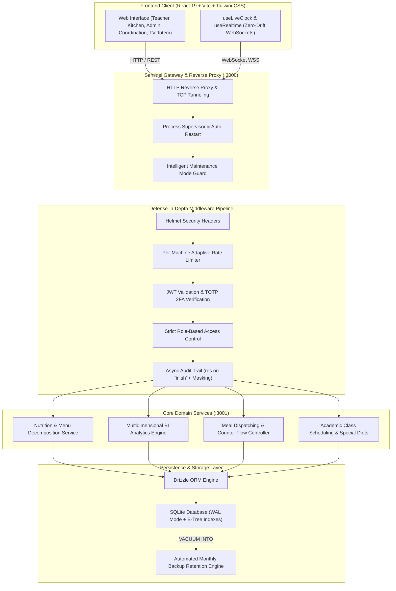

# SESI Alimenta - Enterprise School Nutrition & Academic ERP

<div align="center">

[🇺🇸 English](README.md) | [🇧🇷 Português](README.pt-BR.md)

<p align="center">
  
  
  
  
  
  
  
</p>

<p align="center">
  <strong>Mission-critical, high-concurrency School Food Logistics, Waste Prevention, and Academic Cafeteria ERP.</strong><br />
  Engineered for private school networks and enterprise education hubs with rigorous LGPD compliance.
</p>

</div>

---

## 📌 Overview & Real-World Challenge

In enterprise educational environments, thousands of students enter the cafeteria during synchronized 20-minute break windows. Traditional web systems collapse under the sudden surge of concurrent traffic or suffer data corruption from concurrent file access. Concurrently, kitchen managers face critical operational bottlenecks:

1. **Catastrophic Concurrency Spikes:** Turnstile counters, teachers taking attendance, kitchen displays, and interactive public displays hammering the API simultaneously.
2. **Clinical Dietary Restrictions & LGPD Compliance:** Managing life-critical allergies and religious restrictions without exposing underage student identities or medical records.
3. **Menu Breakdown & Nutritional Waste Management:** Decomposing multi-component dishes into individual nutritional items, tracking edible leftovers vs. plate scrapings, and deriving predictive purchasing insights.
4. **Approval Bottlenecks:** Real-time counter-turn requests requiring immediate sign-off by academic coordinators.

**SESI Alimenta** solves this with an architectural defense-in-depth model, sub-millisecond SQLite WAL data pipelining, and automated nutritional analytics.

---

## ⚡ Engineering Highlights

### 1. High-Concurrency SQLite WAL & B-Tree Indexing
* **WAL (Write-Ahead Logging) Mode:** Multiple parallel readers do not block writers. Readers query snapshots while write locks complete in microsecond bursts.
* **Busy Timeout (5,000ms):** Thread queuing eliminates `SQLITE_BUSY` contention errors during school interval rushes.
* **Synchronous = NORMAL & B-Tree Indexes:** Dedicated B-Tree indexes on `calendario(data)`, `presenca_geral(data)`, `auditoria_lixo(data)`, `aluno_turmas(turma_id)` eliminate full table scans.

### 2. Multidimensional BI & Menu Decomposition Engine
* **Hierarchical Dish Separation:** Clean decomposition between morning snack (`LM`), formal lunch (`A`), and afternoon snack (`LT`). Enforces structural separation rules (e.g. lunch never contains beverages; side dishes are strictly bound to lunch).
* **Predictive BI Analytics:** Real-time computation of per-capita plate waste (attention threshold $\le 25\text{g}$, critical $\ge 45\text{g}$), clean pan leftovers, and multi-category historical acceptance series.
* **Teacher Feedback Hub:** Anonymized teacher review aggregates and bidirectional synchronization.

### 3. Defense-in-Depth Security (AppSec)
* **JWT & Mandatory TOTP 2FA:** Cryptographically signed session tokens combined with RFC 6238 TOTP authentication and backup recovery codes.
* **Strict Role-Based Access Control (RBAC):** Hierarchical permissions isolating `admin`, `cozinha`, `professor`, and `coordenacao` scopes.
* **Cryptographic Device Trust:** Short-lived HMAC signed tokens protecting remembered workstation instances.
* **Asynchronous Silent Audit Trail:** Global middleware tapping `res.on('finish')` to log mutation events asynchronously with automatic masking of sensitive keys (`token`, `senha`, `preAuthToken`, `two_factor_secret`).
* **Zero Insecure Fallbacks:** Fail-fast boot sequence requiring 32+ character entropy for secrets.

### 4. Gateway Resilience & Real-Time Sync
* **Sentinel Reverse Proxy:** Single entry point (:3000) with TCP socket tunneling, health checks, and process lifecycle supervision.
* **Zero-Drift WebSockets:** Heartbeat ping/pong (15s interval) with real-time UI synchronization for kitchen displays and attendance boards.
* **Intelligent Maintenance Mode:** Centralized 503 maintenance page with auto-polling and authorized IP bypass.

### 5. Native Windows Service Daemon
* Production deployment via `node-windows` runs the application as a native Windows Background Service with auto-recovery and crash resilience.

---

## 🏛️ System Architecture



---

## 📸 Application Screenshots

| 2FA Authentication | Kitchen Production Board |
| :---: | :---: |
| *Secure Login with TOTP & Hardware Verification* | *Real-Time Batch Orders & Allergy Alerts* |
| *(Screenshot Placeholder: Login 2FA)* | *(Screenshot Placeholder: Cozinha)* |

| Multidimensional BI Analytics | Coordination Approvals |
| :---: | :---: |
| *Macro Categories, Waste Audit & Approval Trends* | *Counter-Turn Student Meal Authorizations* |
| *(Screenshot Placeholder: Painel BI)* | *(Screenshot Placeholder: Coordenação)* |

---

## 🚀 Quickstart & Installation

### Prerequisites
* **Node.js:** `20.x` or `22.x` LTS
* **npm:** `v10+`

### 1. Clone & Configure
```bash
git clone https://github.com/marcosbinder/SESI-Alimenta.git
cd SESI-Alimenta

# Copy environment configuration template
cp .env.example .env
```

Edit `.env` and provide a secure 64-character secret:
```bash
# Generate key in terminal:
node -e "console.log(require('crypto').randomBytes(64).toString('hex'))"
```

### 2. Install Dependencies & Build
```bash
# Install backend dependencies
npm install

# Build frontend application
cd site
npm install
npm run build
cd ..
```

### 3. Initialize Database & Seed
```bash
# Synchronize SQLite schema and provision initial administrator
node src/scripts/inicializador.js

# Seed default school grade classes and B-Tree indexes
node src/scripts/seedTurmas.js
node src/scripts/criaIndices.js
```

### 4. Run Automated Tests
```bash
npm test
```

### 5. Start Application
```bash
# Start Gateway Sentinel and supervised backend
npm start
```
The application will be accessible at `http://localhost:3000`.

---

## 🧪 Test Suite

The project includes an automated test matrix covering security, cryptographic invariants, backend integrations, and frontend resilience:

```bash
npm test
```

* `tests/test_security.mjs`: Tests payload size limits, exception leakage prevention, bcrypt configuration, cookie security flags, and LGPD anonymization.
* `tests/test_backend_api.mjs`: Validates 2FA cryptographic signatures, session revocation, database constraints, password hashing, and HTML escaping.
* `tests/test_frontend_integrity.mjs`: Tests BI analytical transformations, zero-division guards, typography consistency, and chart caching.
* `tests/test_challenger_m1_1.mjs` & `stress.mjs`: Adversarial stress tests with dirty inputs, NaN resilience, and 10,000+ simulated concurrency records.

---

## 📄 License & Governance

This project is open-source under the [MIT License](LICENSE).  
Copyright (c) 2026 Marcos Binder.
