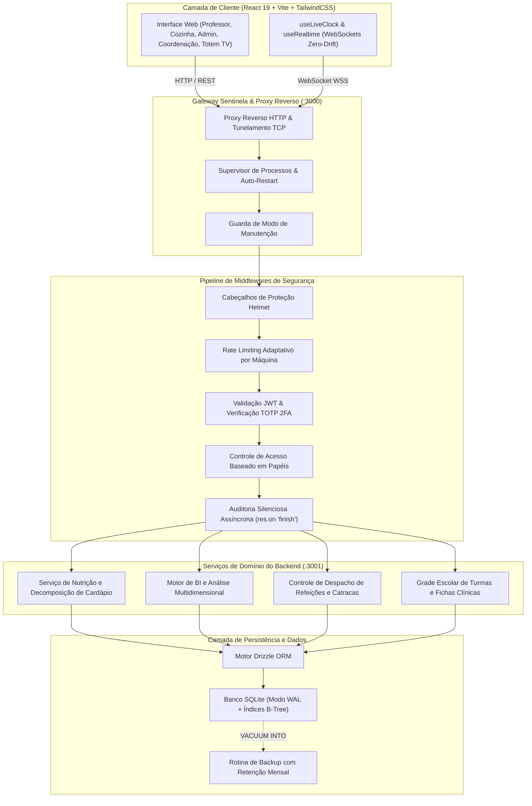
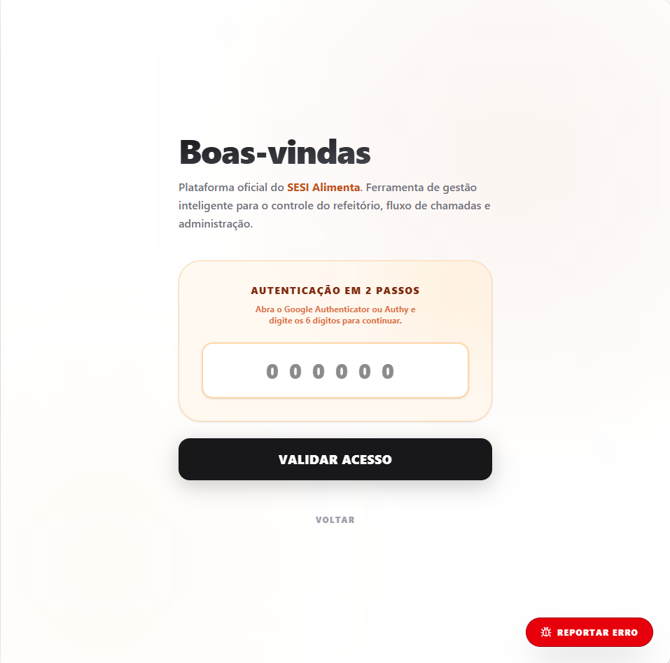
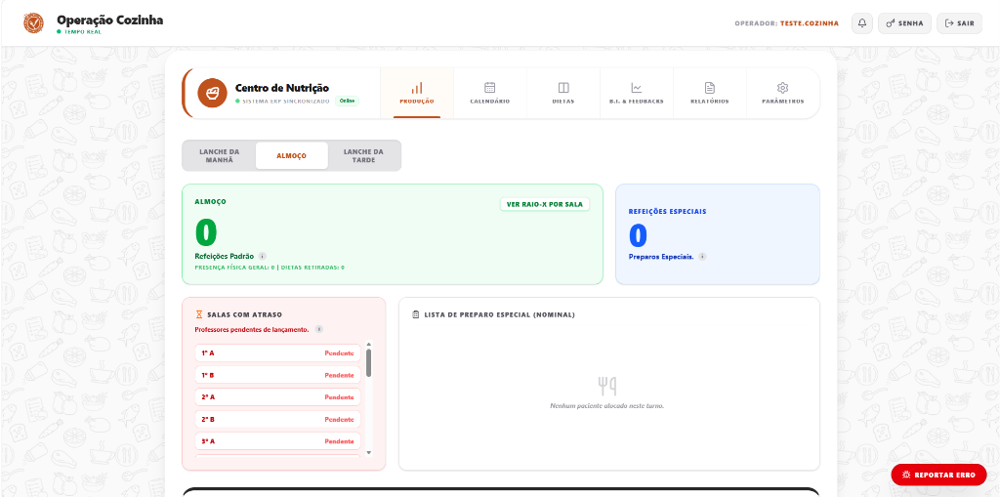
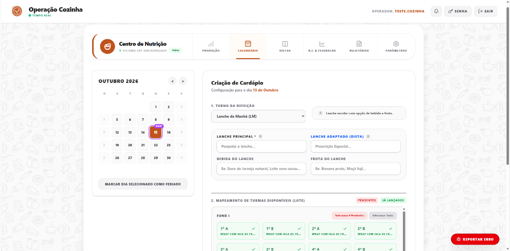
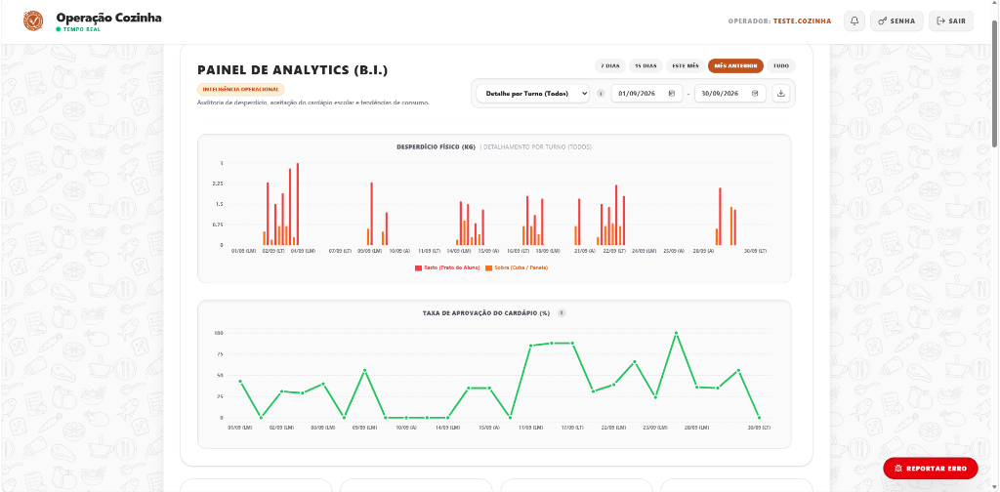

# SESI Alimenta - ERP Corporativo de Gestão Alimentar e Acadêmica

<div align="center">

[🇺🇸 English](README.md) | [🇧🇷 Português](README.pt-BR.md)

<p align="center">
  
  
  
  
  
  
  
</p>

<p align="center">
  <strong>ERP de Missão Crítica para Logística Alimentar Escolar, Prevenção de Desperdício e Gestão de Refeitório.</strong><br />
  Projetado para redes de ensino corporativas e hubs educacionais com rigorosa conformidade com a LGPD.
</p>

</div>

---

## 📌 Visão Geral & O Problema Resolvido

Em ecossistemas escolares de grande porte, milhares de alunos convergem simultaneamente para o refeitório em janelas de intervalo de 20 minutos. Softwares tradicionais sofrem contenção de locks no banco de dados e travamentos sob rajadas repentinas de tráfego. Simultaneamente, as equipes de nutrição enfrentam desafios críticos:

1. **Gargalo de Concorrência Extrema no Intervalo:** Catracas, chamadas em sala de aula pelos professores, painéis operacionais da cozinha e totens rotativos consultando a API no mesmo segundo.
2. **Restrições Alimentares Clínicas & LGPD:** Controle rigoroso de alergias severas (celíacos, intolerância à lactose, diabéticos) e dietas religiosas sem violar a privacidade de menores de idade nem expor fichas clínicas.
3. **Decomposição Nutricional e Prevenção de Desperdício:** Separação precisa de cardápios (prato principal, guarnições, opções vegetarianas), auditoria de sobras limpas (panelas) e restos de ingesta (pratos), gerando inteligência preditiva para compras.
4. **Fluxos de Autorização em Tempo Real:** Solicitações de almoço de contraturno com aprovação imediata pela coordenação pedagógica.

O **SESI Alimenta** soluciona essa demanda através de uma arquitetura resiliente com SQLite em modo WAL de alta velocidade, supervisão contínua por Gateway Sentinela e motor analítico multidimensional de BI.

---

## ⚡ Destaques de Engenharia

### 1. SQLite de Alta Concorrência em Modo WAL & Índices B-Tree
* **Modo WAL (Write-Ahead Logging):** Leitores concorrentes não bloqueiam escritores e vice-versa. As leituras operam sobre snapshots atômicos enquanto as escritas ocorrem em microssegundos.
* **Busy Timeout (5.000ms):** Enfileiramento nativo de conexões concorrentes, eliminando qualquer risco de erro `SQLITE_BUSY` durante os picos do intervalo.
* **Synchronous = NORMAL & Índices B-Tree:** Índices dedicados em `calendario(data)`, `presenca_geral(data)`, `auditoria_lixo(data)` e `aluno_turmas(turma_id)` erradicam varreduras sequenciais completas (*Full Table Scans*).

### 2. Motor de BI Multidimensional & Decomposição Estruturada de Cardápio
* **Separação Estrutural de Refeições:** Segregação estrita entre Lanche da Manhã (`LM`), Almoço (`A`) e Lanche da Tarde (`LT`). Regras sanitárias aplicadas no schema (ex.: almoço nunca contém sucos/bebidas artificiais; acompanhamentos são restritos ao almoço).
* **BI Preditivo em Tempo Real:** Cálculo contínuo de resto *per capita* (faixa de atenção $\le 25\text{g}$, crítica $\ge 45\text{g}$), sobras limpas e curvas históricas de aceitação por categoria alimentar.
* **Mural de Feedbacks Pedagógicos:** Leitura e persistência de avaliações dos professores com marcação de leitura em lote e sincronização bidirecional.

### 3. Segurança em Profundidade (Defense-in-Depth & LGPD)
* **JWT com TOTP 2FA Obrigatório:** Tokens de sessão com versionamento (`token_version`) associados a autenticação de dois fatores baseada em tempo (RFC 6238) e códigos de recuperação de emergência.
* **Controle de Acesso Estrito (RBAC):** Isolamento categórico entre os papéis `admin`, `cozinha`, `professor` e `coordenacao`.
* **Device Trust Criptográfico:** Validação de máquinas de confiança com tokens de curta duração assinados via HMAC-SHA256.
* **Auditoria Silenciosa Assíncrona:** Interceptação no ciclo de vida da resposta via `res.on('finish')`, mascarando automaticamente credenciais e chaves sensíveis (`senha`, `token`, `preAuthToken`, `two_factor_secret`) sem atrasar o retorno HTTP.
* **Tolerância Zero a Segredos com Fallback:** Inicialização do servidor com encerramento imediato caso `JWT_SECRET` esteja ausente ou contenha menos de 32 caracteres.

### 4. Resiliência do Gateway Sentinela & Sincronização em Tempo Real
* **Proxy Reverso Sentinela:** Ponto único de entrada na rede (:3000) com supervisão de processos filhos, verificação de saúde (*health-checks*) e reinicialização automática.
* **WebSockets com Heartbeat Anti-Zumbi:** Ping/pong a cada 15 segundos garantindo sincronização instantânea das telas da cozinha, totem e coordenação.
* **Modo Manutenção Inteligente:** Interceptador que serve página 503 informativa com reconexão automática, liberando acesso prioritário apenas para IPs de TI autorizados.

### 5. Serviço Nativo do Windows (Background Daemon)
* Operação corporativa gerenciada via `node-windows`, rodando de forma resiliente e transparente na inicialização do sistema operacional da escola.

---

## 🏛️ Diagrama de Arquitetura



---

## 📸 Capturas de Tela do Sistema

| Portal de Acesso Institucional | Autenticação em 2 Passos (2FA TOTP) |
| :---: | :---: |
| *Tela de login adaptativa com termos LGPD e atalho para dashboard público* | *Validação obrigatória de 6 dígitos via Authenticator com reconhecimento de dispositivo* |
|  |  |

| Central de Operação da Cozinha | Planejamento & Decomposição de Cardápio |
| :---: | :---: |
| *Painel em tempo real de chamadas, contagem de porções e dietas especiais* | *Montagem de cardápio por data/turno com regras de separação nutricional* |
|  |  |

<p align="center">
  <strong>Painel de Business Intelligence (B.I.) & Auditoria de Desperdício</strong><br />
  <em>Acompanhamento de sobras limpas, resto de prato (kg) e curva histórica de aprovação do cardápio escolar</em><br />
  
</p>

---

## 🚀 Guia de Instalação e Execução

### Pré-requisitos
* **Node.js:** Versão `20.x` ou `22.x` LTS
* **npm:** Versão `v10+`

### 1. Clonagem e Configuração do Ambiente
```bash
git clone https://github.com/marcosbinder/SESI-Alimenta.git
cd SESI-Alimenta

# Criar o arquivo .env a partir do modelo seguro
cp .env.example .env
```

Abra o arquivo `.env` e configure sua chave secreta mestra (mínimo de 32 caracteres):
```bash
# Gerar chave aleatória forte no terminal:
node -e "console.log(require('crypto').randomBytes(64).toString('hex'))"
```

### 2. Instalação de Dependências e Build do Frontend
```bash
# Instalar dependências da API do backend
npm install

# Compilar a aplicação cliente estática
cd site
npm install
npm run build
cd ..
```

### 3. Inicialização e Migração do Banco de Dados
```bash
# Cria o esquema no SQLite e provisiona o administrador base
node src/scripts/inicializador.js

# Mapeia a estrutura acadêmica de turmas e injeta os índices B-Tree
node src/scripts/seedTurmas.js
node src/scripts/criaIndices.js
```

### 4. Execução dos Testes Automatizados
```bash
npm test
```

### 5. Inicialização da Aplicação
```bash
# Inicializa o Gateway Sentinela e supervisiona o backend
npm start
```
O sistema estará disponível em `http://localhost:3000`.

---

## 🧪 Suíte de Testes Automatizados

O repositório possui cobertura abrangente de testes validando integridade, estresse e segurança:

```bash
npm test
```

* `tests/test_security.mjs`: Valida limite de payload, mascaramento de erros internos, versão do bcrypt, cookies e anonimização de dados pessoais (LGPD).
* `tests/test_backend_api.mjs`: Valida assinaturas de 2FA, revogação de tokens de sessão, integridade relacional de tabelas e sanitização contra XSS.
* `tests/test_frontend_integrity.mjs`: Valida cálculos de BI, proteção de renderização do Recharts, relógio sincronizado e prevenção de telas brancas.
* `tests/test_challenger_m1_1.mjs` & `stress.mjs`: Testes adversariais com dados corrompidos, divisão por zero e estresse de volume com 10.000 registros.

---

## 📄 Licença e Propriedade Intelectual

Distribuído sob a licença de código aberto **GNU Affero General Public License v3.0 (GNU AGPLv3)**.  
Copyright (c) 2026 Marcos Binder.

Sob os termos da AGPLv3, qualquer modificação, trabalho derivado ou instância operada como serviço de rede (intranet escolar ou nuvem) é obrigado a disponibilizar integralmente o código-fonte correspondente sob os mesmos termos. O fechamento proprietário do código é estritamente proibido.
