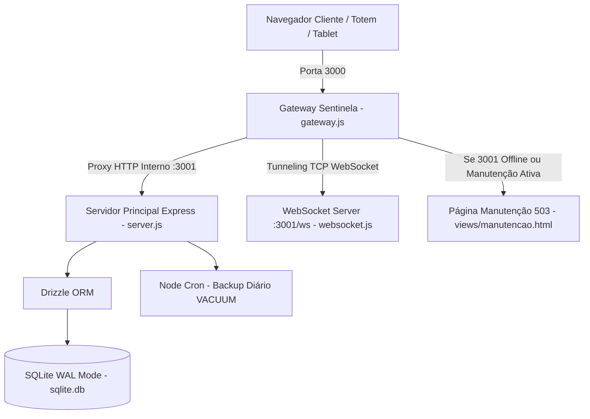

# 🍱 SESI Alimenta — Master System Documentation & Context Reference

> **Documento Mestre do Sistema** — Este arquivo consolida toda a arquitetura, regras de negócio, estrutura de arquivos, modelo de dados, decisões de engenharia, diretrizes de desenvolvimento e o backlog do projeto **SESI-Alimenta**.  
> **Finalidade**: Servir como referência única e autoritativa para qualquer novo agente de IA ou desenvolvedor, permitindo continuidade imediata de contexto sem desperdício de tokens.

---

## 📑 Sumário Executivo

- [1. Visão Geral do Produto e Escopo](#1-visão-geral-do-produto-e-escopo)
- [2. Topologia da Arquitetura](#2-topologia-da-arquitetura)
- [3. Modelo de Dados e Banco de Dados (SQLite + Drizzle ORM)](#3-modelo-de-dados-e-banco-de-dados-sqlite--drizzle-orm)
- [4. Segurança, Autenticação e 2FA](#4-segurança-autenticação-e-2fa)
- [5. Sincronização em Tempo Real (WebSocket)](#5-sincronização-em-tempo-real-websocket)
- [6. Sistema de Manutenção e Gateway Sentinela](#6-sistema-de-manutenção-e-gateway-sentinela)
- [7. Dicionário Completo de Arquivos do Projeto](#7-dicionário-completo-de-arquivos-do-projeto)
  - [7.1 Backend & Infraestrutura (`src/`)](#71-backend--infraestrutura-src)
  - [7.2 Frontend React SPA (`site/src/`)](#72-frontend-react-spa-sitesrc)
  - [7.3 Scripts Utilitários & Testes](#73-scripts-utilitários--testes)
- [8. Métricas de Nutrição e Business Intelligence (BI)](#8-métricas-de-nutrição-e-business-intelligence-bi)
- [9. Regras de Ouro e Diretrizes para Agentes de IA](#9-regras-de-ouro-e-diretrizes-para-agentes-de-ia)
- [10. Backlog e Próximas Implementações](#10-backlog-e-próximas-implementações)

---

## 1. Visão Geral do Produto e Escopo

O **SESI Alimenta** é um sistema ERP de gestão escolar e alimentar desenhado para alta concorrência em ambiente de intranet escolar. O sistema integra a rotina de professores, coordenação pedagógica, equipe de nutrição/cozinha e administração de TI, além de disponibilizar um totem público com informações nutricionais e índices de aprovação.

### Principais Objetivos do Sistema:
1. **Controle de Presenças e Refeições**: Lançamento diário de chamadas por turma e registro de alunos presentes para dimensionamento exato da produção.
2. **Gestão de Restrições Alimentares (Dietas)**: Rastreamento individual de alunos com alergias, intolerâncias e restrições clínicas, garantindo produção segura.
3. **Auditoria de Desperdício e Lixo**: Pesagem diária de sobra limpa (alimento produzido não servido) e resto ingesta (alimento descartado pelos alunos no prato).
4. **Business Intelligence (BI) & Nutrição**: Cálculo de indicadores nutricionais como **DPC** (Desperdício Per Capita), **IAL** (Índice de Aceitação e Lixo) e **TRO** (Taxa de Resto Ingesta), gráficos de aprovação por cardápio e mural de feedbacks.
5. **Solicitações de Almoço de Contraturno**: Fluxo formal onde professores solicitam refeições para alunos em projetos extracurriculares e a coordenação avalia/aprova.
6. **Totem / Dashboard Público**: Terminal instalado na entrada do refeitório exibindo cardápio do dia, ranking de aprovação dos pratos e gráficos semanais.

---

## 2. Topologia da Arquitetura

O sistema adota uma arquitetura em camadas resiliente a falhas e otimizada para execução local como Serviço do Windows:

### Componentes de Rede:
- **Porta 3000 (`GATEWAY_PORT`)**: Ponto de entrada público da aplicação.
- **Porta 3001 (`BACKEND_PORT`)**: Processo filho supervisionado (Node.js Express + WebSocket).
- **Modo WAL do SQLite**: Write-Ahead Logging nativo com `busy_timeout = 5000` para concorrência de leitura e escrita sem bloqueio.

---

## 3. Modelo de Dados e Banco de Dados (SQLite + Drizzle ORM)

O banco é estruturado em SQLite utilizando Drizzle ORM (`src/db/schema.js`). As tabelas principais são:

| Tabela | Descrição |
| :--- | :--- |
| `usuarios` | Contas de acesso (`admin`, `professor`, `cozinha`, `coordenacao`), hash bcrypt, status ativo, segredo TOTP 2FA e códigos de recuperação. |
| `turmas` | Cadastro de turmas escolares (`nivel`: Fundamental 1, Fundamental 2, Ensino Médio, SENAI, Personaliza; `ano`, `identificador`). |
| `dias_nao_letivos` | Feriados e recessos escolares cadastrados por data (`YYYY-MM-DD`). |
| `dias_ignorados_turma` | Exceções de calendário para turmas específicas em determinados dias. |
| `restricoes` | Catálogo de alergias/restrições (ex: Lactose, Glúten, Diabetes, APLV). |
| `alunos_especiais` | Alunos com laudo médico ou necessidades alimentares especiais. |
| `aluno_turmas` | Relação N:N entre aluno e turma (`tipo_vinculo`: 'Base' ou contraturno). |
| `aluno_restricoes` | Relação N:N entre aluno e suas respectivas restrições alimentares. |
| `catalogo_alimentos` | Catálogo segregado de componentes alimentares (`nome`, `categoria`, `ativo`, `criado_em`), com restrição `UNIQUE(nome, categoria)`. Categorias: `lanche`, `prato_principal`, `arroz`, `feijao`, `guarnicao`, `opcao_vegetal`, `molho_salada`, `sobremesa`, `fruta`, `bebida`. |
| `receitas` | Catálogo legado de receitas base mantido para integridade histórica. |
| `calendario` | Cardápio planejado por data, turma e tipo de refeição (`LM`, `A`, `LT`). Suporta decomposição estruturada: `prato_principal`, `prato_principal_dieta`, `arroz`, `feijao`, `guarnicao`, `opcao_vegetal`, `molho_salada`, `sobremesa`, `fruta`, `bebida`, preservando `lanche_padrao` e `lanche_dieta` para 100% de retrocompatibilidade histórica. |
| `presenca_geral` | Quantidade total de alunos presentes por turma, data e turno. |
| `presenca_restricoes` | Registro individual de presença para alunos de dieta especial. |
| `avaliacoes_comida` | Votação de aprovação (`gostaram`, `nao_gostaram`, `observacao`). |
| `auditoria_lixo` | Pesagem de desperdício (`lixo_limpo_kg`, `lixo_sujo_kg`) por turno e data. |
| `solicitacoes_almoco` | Pedidos de almoço avulso com fluxo de aprovação pela coordenação. |
| `feedbacks_lidos` | Persistência de comentários marcados como lidos por usuário (`usuario_id`, `feedback_id`, `lido_em`). |
| `notificacoes` & `notificacoes_lidas` | Sistema de avisos gerais e direcionados com confirmação de leitura. |
| `parametros_sistema` | Coeficientes de peso per capita e metas nutricionais do BI. |
| `logs_sistema` | Auditoria passiva de mutações (`POST`, `PUT`, `DELETE`), erros internos e ações administrativas. |
| `reportes_erro` | Chamados de suporte reportados pelos usuários via interface. |
| `modo_manutencao` | Estado global de manutenção, mensagem exibida, previsão e lista de IPs liberados. |

### 3.1 Arquitetura de Decomposição do Cardápio & Regras Nutricionais SESI

A composição dos cardápios escolares é estritamente diferenciada entre turnos de lanche e almoço:

1. **Lanches (LM - Manhã / LT - Tarde)**:
   - **Lanche Principal** (`lanche` / `lanche_padrao`): Obrigatório (ex: *Wrap de frango*, *Bolo de milho*).
   - **Bebida** (`bebida`): Opcional/Sugerido (ex: *Suco de uva*, *Leite com cacau*).
   - **Fruta** (`fruta`): Opcional/Sugerido (ex: *Maçã*, *Banana prata*).
   - **Lanche Adaptado / Dieta** (`lanche_dieta`): Opcional, para alunos com restrição clínica.
   - *Campos de almoço* (`arroz`, `feijao`, `guarnicao`, etc.) são forçados como `null` no backend para evitar inconsistências.

2. **Almoço Escolar (A - Almoço)**:
   - **Prato Principal / Mistura** (`prato_principal`): Obrigatório (ex: *Filé de frango*, *Carne de panela*).
   - **Arroz** (`arroz`): Opcional/Sugerido (ex: *Arroz Branco*, *Arroz Integral*).
   - **Feijão** (`feijao`): Opcional/Sugerido (ex: *Feijão Carioca*, *Feijão Preto*).
   - **Opção Vegetal / Salada** (`opcao_vegetal`): Opcional (ex: *Salada de Alface e Tomate*).
   - **Guarnição** (`guarnicao`): Opcional (ex: *Purê de batata*, *Farofa rica*).
   - **Molho da Salada** (`molho_salada`): Opcional (ex: *Molho de Ervas Finas*).
   - **Sobremesa** (`sobremesa`): Opcional (ex: *Gelatina de Morango*).
   - **Fruta** (`fruta`): Opcional (ex: *Laranja pera*).
   - **Mistura Adaptada / Dieta** (`prato_principal_dieta`): Opcional para restrições alimentares.
   - 🚫 **Regra Institucional Rígida**: O almoço escolar **NÃO POSSUI BEBIDA** (`bebida = null`). Essa norma segue diretrizes nutricionais escolares do SESI para não diluir o suco gástrico durante refeições pesadas. A trava é aplicada tanto no formulário quanto na rota `POST /calendario/salvar`.

3. **Auto-registro & Higienização do Catálogo**:
   - Ao lançar um cardápio, componentes digitados que ainda não constam no `catalogo_alimentos` são automaticamente inseridos via `limparTexto` (removendo caracteres invisíveis como zero-width spaces `\u200B-\u200D\uFEFF`) com cláusula `onConflictDoNothing()`.

4. **Preservação Histórica & Retrocompatibilidade (Zero Data Loss)**:
   - Todos os 451 registros legados em `calendario` mantêm `lanche_padrao` preservado e receberam preenchimento em `prato_principal`.
   - Novos registros sincronizam sempre `lanche_padrao: padraoFinal`, garantindo que consultas, relatórios antigos e exportações continuem funcionando sem quebras.

5. **Anti-Poluição do B.I. & Comparativo de Desempenho Modernizado**:
   - O B.I. (`EstatisticasBI.jsx` e `analytics.js`) extrai pratos comparáveis estritamente dos dados consolidados de refeições efetivamente servidas (`historicoBI`), eliminando pratos de teste, receitas rascunho ou itens fantasmas.
   - O bloco obsoleto "Variedade Nutricional" foi descontinuado e removido do painel.
   - O **Comparativo de Desempenho** foi totalmente modernizado: permite cruzar itens de categorias distintas ou intra-categoria (Prato Principal, Lanche, Salada/Vegetal, Guarnição, Molho, Arroz, Feijão, Fruta, Sobremesa, Bebida), conta com confronto direto **Head-to-Head** (Taxa de Aprovação, Resto no Prato, Sobra na Cuba, Frequência e Amostras) integrado ao Radar Multidimensional.
   - O antigo "Totem Público" foi renomeado para **Dashboard Público** (`/dashboard-publico`), com redirecionamento transparente de `/totem-publico`.

---

## 4. Segurança, Autenticação e 2FA

- **JWT em Cookies HttpOnly**: Sessões assinadas com `JWT_SECRET`. Tokens de administradores expiram em 10 minutos; demais perfis expiram em 12 horas.
- **2FA Obrigatório para TI (TOTP)**: Administradores utilizam autenticação em dois fatores baseada em tempo (`speakeasy` + `qrcode` + `otplib`) com suporte a 5 códigos de recuperação descartáveis em caso de perda do autenticador.
- **Anti-Enumeração**: Mensagem de erro padronizada no login (`"Senha ou usuário incorreto."`).
- **Rate Limiting**:
  - `limitadorLoginIP`: Máximo 40 tentativas por IP em 15 minutos.
  - `limitadorLoginUsuario`: Máximo 10 tentativas por nome de usuário em 15 minutos.
  - `limitadorGlobal`: 1500 requisições por IP a cada 15 minutos.
- **Sanitização XSS**: Uso estrito de `sanitize-html` em campos de texto livre (justificativas, motivos, observações).
- **Auditoria Silenciosa**: Middleware global via `res.on('finish')` grava logs estruturados no banco mascarando automaticamente senhas, tokens e segredos 2FA.

---

## 5. Sincronização em Tempo Real (WebSocket)

O sistema possui um servidor WebSocket nativo integrado na rota `/ws` (`src/websocket.js`):

- **Eventos Transmitidos**:
  - `presenca_atualizada`: Notifica a cozinha instantaneamente quando uma chamada é lançada.
  - `cozinha_atualizada`: Notifica mudanças de cardápio, lixo ou parâmetros.
  - `cardapio_atualizado`: Sincroniza visões docentes e públicas.
  - `manutencao_status`: Notifica todos os navegadores abertos para exibir/ocultar a tela de manutenção em tempo real sem necessidade de recarregar a página (F5).
  - `status_clientes`: Informa ao painel Admin quantas máquinas e quais IPs estão conectados.
- **Hook Frontend (`useRealtime.js`)**: Encapsula listeners do evento customizado do navegador `sesi-ws-event`.

---

## 6. Sistema de Manutenção e Gateway Sentinela

O `src/gateway.js` atua como um proxy reverso e supervisor de processos:

1. **Supervisão Automática**: Se o processo do servidor principal (`src/server.js`) falhar ou for finalizado, o gateway detecta e reinicia o processo automaticamente em 1,5 segundos.
2. **Separação Localhost vs Intranet**:
   - Requisições originadas de `localhost` ou `127.0.0.1` possuem passe-livre para testes locais.
   - Requisições externas/intranet recebem a página `503 Service Unavailable` estilizada quando o modo de manutenção está ativado.
3. **Bypass Administrativo**: Rotas de `/admin`, `/api/admin`, `/api/login` permanecem acessíveis para que a equipe de TI possa autenticar com 2FA e desativar a manutenção.
4. **Modal de Emergência**: O frontend possui um overlay de manutenção (`ManutencaoOverlay.jsx`) com botão para desbloqueio emergencial via código 2FA.

---

## 7. Dicionário Completo de Arquivos do Projeto

### 7.1 Backend & Infraestrutura (`src/`)

- [server.js](file:///c:/Users/Nutri/Documents/SESI-Alimenta/src/server.js): Inicialização do Express, middlewares globais (Helmet, Compression, CORS, Rate Limit, Auditoria Passiva), tratamento global de exceções, rotas `/api/*`, cron de backup diário (`VACUUM INTO`) e bootstrapping do WebSocket.
- [gateway.js](file:///c:/Users/Nutri/Documents/SESI-Alimenta/src/gateway.js): Processo master supervisor. Roda na porta 3000, gerencia o ciclo de vida do backend na porta 3001, realiza health checks a cada 1.5s, faz upgrade TCP de conexões WebSocket e serve fallback HTML de manutenção.
- [websocket.js](file:///c:/Users/Nutri/Documents/SESI-Alimenta/src/websocket.js): Servidor WebSocket (`ws`) na rota `/ws`. Controla clientes conectados, heartbeat de 15 segundos e disparo de broadcasts globais (`broadcastEvento`).
- [db/schema.js](file:///c:/Users/Nutri/Documents/SESI-Alimenta/src/db/schema.js): Definição de esquema relacional completo em Drizzle ORM (tabelas de usuários, turmas, dietas, auditoria, `catalogo_alimentos` com unicidade `(nome, categoria)` e `calendario` com 10 colunas estruturadas de acompanhamentos).
- [db/index.js](file:///c:/Users/Nutri/Documents/SESI-Alimenta/src/db/index.js): Conexão com SQLite (`@libsql/client`), ativação do modo WAL, migrações automáticas de schema (`ALTER TABLE` defensivo), sementes padronizadas do catálogo alimentar e índices essenciais (`idx_catalogo_categoria`).
- [middlewares/manutencao.js](file:///c:/Users/Nutri/Documents/SESI-Alimenta/src/middlewares/manutencao.js): Interceptador de manutenção que valida tokens de Admin, requisições de localhost e lista branca de IPs.
- [routes/auth.js](file:///c:/Users/Nutri/Documents/SESI-Alimenta/src/routes/auth.js): Endpoints de autenticação: `/login`, `/login/ativar-2fa`, `/login/validar-2fa`, `/alterar-minha-senha`, `/logout`.
- [routes/admin.js](file:///c:/Users/Nutri/Documents/SESI-Alimenta/src/routes/admin.js): Gestão de usuários, alteração de tipo/perfil (`PATCH /admin/usuarios/:id/tipo`), reset de senhas, backups manuais, logs de auditoria, expurgo anual seguro (`/admin/purge`) e controle de manutenção.
- [routes/nutricao.js](file:///c:/Users/Nutri/Documents/SESI-Alimenta/src/routes/nutricao.js): Gestão completa da cozinha: pendências de chamada, projeção de refeições, auditoria de lixo, rotas de catálogo `/catalogo-alimentos` (GET ordenado e POST sanitizado), rota de cardápio estruturado `/calendario/salvar` (validação bifurcada Zod LM/LT vs A, auto-registro no catálogo, imposição de bebida nula no almoço), histórico do BI e persistência de feedbacks lidos.
- [routes/docente.js](file:///c:/Users/Nutri/Documents/SESI-Alimenta/src/routes/docente.js): Painel do professor: listagem de turmas do dia, lançamento de presenças e avaliações de pratos, consulta de alunos com restrição, endpoint `/cardapio-geral-hoje` priorizando `COALESCE(c.prato_principal, c.lanche_padrao)` e `/info-lanches/turma/:id` retornando a bandeja completa com acompanhamentos.
- [routes/coordenacao.js](file:///c:/Users/Nutri/Documents/SESI-Alimenta/src/routes/coordenacao.js): Central de aprovação/rejeição de pedidos de almoço de contraturno, histórico de solicitações e auditoria de cancelamentos.
- [routes/publico.js](file:///c:/Users/Nutri/Documents/SESI-Alimenta/src/routes/publico.js): Endpoint aberto `/publico/dashboard` para totens e telas públicas (cardápio estruturado por turno com todos os acompanhamentos e dietas, ranking de aceitação genuíno baseado exclusivamente em avaliações de sala de aula com `COALESCE(c.prato_principal, c.lanche_padrao)`).
- [routes/notificacoes.js](file:///c:/Users/Nutri/Documents/SESI-Alimenta/src/routes/notificacoes.js): Sistema de comunicados gerais com controle de leitura por usuário.
- [utils/fuzzy.js](file:///c:/Users/Nutri/Documents/SESI-Alimenta/src/utils/fuzzy.js): Algoritmo de cálculo de similaridade textual para detecção de nomes duplicados e buscas aproximadas.
- [views/manutencao.html](file:///c:/Users/Nutri/Documents/SESI-Alimenta/src/views/manutencao.html): Template HTML/CSS moderno servido pelo Gateway durante indisponibilidade do backend.

---

### 7.2 Frontend React SPA (`site/src/`)

- [main.jsx](file:///c:/Users/Nutri/Documents/SESI-Alimenta/site/src/main.jsx): Ponto de entrada React 18, montagem do DOM e estilos globais.
- [App.jsx](file:///c:/Users/Nutri/Documents/SESI-Alimenta/site/src/App.jsx): Roteador principal baseado em papéis, suporte canônico à rota `/dashboard-publico` (com alias `/totem-publico`), gerenciamento da conexão WebSocket global, notificações flutuantes e controle do overlay de manutenção.
- [Login.jsx](file:///c:/Users/Nutri/Documents/SESI-Alimenta/site/src/Login.jsx): Tela de autenticação com etapas de 2FA, recuperação de conta, atalho direto para o Dashboard Público (`/dashboard-publico`) e link para termos de consentimento.
- [Admin.jsx](file:///c:/Users/Nutri/Documents/SESI-Alimenta/site/src/Admin.jsx): Painel de TI: gestão de operadores, downloads de backups, monitor de clientes conectados em tempo real, logs do sistema e controle de manutenção.
- [Cozinha.jsx](file:///c:/Users/Nutri/Documents/SESI-Alimenta/site/src/Cozinha.jsx): Hub operacional da cozinha e nutrição: controle de abas, sincronização em tempo real, autocompletes alimentados por `obterOpcoesCatalogo()`, persistência estruturada de cardápio (Lanche vs Almoço), unificação via modal fuzzy e resolução de pendências retroativas.
- [Professor.jsx](file:///c:/Users/Nutri/Documents/SESI-Alimenta/site/src/Professor.jsx): Interface para docentes realizarem a chamada diária e registrarem a avaliação dos alunos, com visualização da bandeja de alimentação escolar e chips visuais dos acompanhamentos (com pontos coloridos por categoria e tooltips, sem prefixos textuais redundantes) no Passo 2 e Passo 4.
- [Coordenacao.jsx](file:///c:/Users/Nutri/Documents/SESI-Alimenta/site/src/Coordenacao.jsx): Painel de triagem e aprovação de almoços de contraturno para alunos em projetos escolares.
- [PublicDashboard.jsx](file:///c:/Users/Nutri/Documents/SESI-Alimenta/site/src/PublicDashboard.jsx): Interface visual do Dashboard Público (antigo Totem) com rotação automática de dados, exibição detalhada da bandeja escolar do dia com chips visuais sem prefixos textuais, ranking dos pratos favoritos dos alunos livre de dados mockados e indicadores de sustentabilidade.
- [Apresentacao.jsx](file:///c:/Users/Nutri/Documents/SESI-Alimenta/site/src/Apresentacao.jsx): Deck interativo de apresentação das funcionalidades e regras do SESI Alimenta.
- [NotFound.jsx](file:///c:/Users/Nutri/Documents/SESI-Alimenta/site/src/NotFound.jsx): Tela 404 estilizada com redirecionamento inteligente.
- [TermosDeConsentimento.jsx](file:///c:/Users/Nutri/Documents/SESI-Alimenta/site/src/TermosDeConsentimento.jsx): Visualização dos termos de uso e conformidade com LGPD.
- [components/EstatisticasBI.jsx](file:///c:/Users/Nutri/Documents/SESI-Alimenta/site/src/components/EstatisticasBI.jsx): Módulo de Business Intelligence com Recharts: badge de novos feedbacks com proteção anti-quebra de linha (`whitespace-nowrap`), Comparativo de Alimentos & Desempenho multidimensional com 3 sub-abas (Comparar 2 Alimentos com cartões de confronto direto e radar sem duplicidade de legendas, Tabela de Alimentos com persistência de seleção e botões ativos intuitivos, e Resumo Macro por Categoria segregado entre grupos ativos e inativos), exportação analítica completa para CSV com colunas de acompanhamentos estruturados, proteção contra poluição de dados, taxa de aprovação contínua e mural de feedbacks com histórico de lidos.
- [components/ManutencaoOverlay.jsx](file:///c:/Users/Nutri/Documents/SESI-Alimenta/site/src/components/ManutencaoOverlay.jsx): Bloqueio visual dinâmico com formulário de desbloqueio de emergência para a equipe técnica.
- [components/ReportErrorButton.jsx](file:///c:/Users/Nutri/Documents/SESI-Alimenta/site/src/components/ReportErrorButton.jsx): Botão flutuante para abertura rápida de chamados de suporte pelo usuário final.
- [components/SessionTimer.jsx](file:///c:/Users/Nutri/Documents/SESI-Alimenta/site/src/components/SessionTimer.jsx): Alerta visual e contagem regressiva de expiração da sessão com renovação automática.
- [components/UI.jsx](file:///c:/Users/Nutri/Documents/SESI-Alimenta/site/src/components/UI.jsx): Componentes de UI reutilizáveis (botões, inputs, modais e badges).
- [components/cozinha/*](file:///c:/Users/Nutri/Documents/SESI-Alimenta/site/src/components/cozinha/):
  - `ProducaoTab.jsx`: Projeção de porções por turno e dietas especiais do dia.
  - `HistoricoDiaPassado.jsx` / `HistoricoDiaPassadoTab.jsx`: Pesagem de lixo do dia anterior, conciliação de presenças e rastreabilidade granular do cardápio servido com chips visuais dos acompanhamentos (Arroz, Feijão, Salada, Molho, Guarnição, Sobremesa, Fruta, Bebida).
  - `CalendarioTab.jsx`: Planejamento mensal de cardápios com formulário inteligente bifurcado (Lanches vs Almoço), autocompletes por categoria do catálogo alimentar e injeção em lote por agrupamentos de turmas.
  - `DietasTab.jsx`: Cadastro clínico de alunos especiais e restrições.
  - `ParametrosTab.jsx`: Configuração de gramaturas e metas de desperdício.
  - `RelatoriosTab.jsx`: Emissão de relatórios operacionais e exportação.
  - `SharedUI.jsx`: Elementos visuais compartilhados do módulo da cozinha.
- [hooks/useRealtime.js](file:///c:/Users/Nutri/Documents/SESI-Alimenta/site/src/hooks/useRealtime.js): Hook de assinatura de eventos de WebSocket no frontend.
- [hooks/useAntiFlicker.js](file:///c:/Users/Nutri/Documents/SESI-Alimenta/site/src/hooks/useAntiFlicker.js): Prevenção de oscilação visual durante trocas de rotas e carregamentos rápidos.
- [hooks/useLiveClock.js](file:///c:/Users/Nutri/Documents/SESI-Alimenta/site/src/hooks/useLiveClock.js): Relógio sincronizado com o tempo oficial do servidor.
- [services/api.js](file:///c:/Users/Nutri/Documents/SESI-Alimenta/site/src/services/api.js): Cliente HTTP centralizado com injeção automática de credenciais, tratamento unificado de erros e auto-logout em respostas 401/403.
- [utils/analytics.js](file:///c:/Users/Nutri/Documents/SESI-Alimenta/site/src/utils/analytics.js): Motor de processamento matemático de BI, agrupamento dinâmico por prato principal (`prato_principal || lanche_padrao`), montagem de detalhes de acompanhamentos no mural de feedbacks, sanitização de valores numéricos, comparativo multidimensional multi-categoria e geração de chaves determinísticas para gráficos.
- [utils/time.js](file:///c:/Users/Nutri/Documents/SESI-Alimenta/site/src/utils/time.js): Sincronizador de relógio cliente-servidor com compensação de latência de rede.

---

### 7.3 Scripts Utilitários & Testes

- [package.json](file:///c:/Users/Nutri/Documents/SESI-Alimenta/package.json): Scripts de execução (`npm test`, `npm run dev`, `npm run start`).
- [tests/test_security.mjs](file:///c:/Users/Nutri/Documents/SESI-Alimenta/tests/test_security.mjs): Bateria de testes de segurança de backend (injeção SQL, validação de tokens, rate limiting e sanitização).
- [tests/test_backend_api.mjs](file:///c:/Users/Nutri/Documents/SESI-Alimenta/tests/test_backend_api.mjs): Testes de integração das APIs Express, 2FA, regras de cardápio e banco de dados.
- [tests/test_frontend_integrity.mjs](file:///c:/Users/Nutri/Documents/SESI-Alimenta/tests/test_frontend_integrity.mjs): Integridade de componentes React, verificação de zero emojis e resiliência de UI.
- [tests/test_challenger_m1_1.mjs](file:///c:/Users/Nutri/Documents/SESI-Alimenta/tests/test_challenger_m1_1.mjs): Testes empíricos de integridade dos cálculos do BI e sincronização de tempo.
- [tests/test_challenger_m1_1_stress.mjs](file:///c:/Users/Nutri/Documents/SESI-Alimenta/tests/test_challenger_m1_1_stress.mjs): Teste de estresse com 10.000 registros para garantir estabilidade e ausência de travamentos.
- [src/scripts/instalar-servico.js](file:///c:/Users/Nutri/Documents/SESI-Alimenta/src/scripts/instalar-servico.js): Registra o gateway como Serviço nativo do Windows (`node-windows`).
- [src/scripts/desinstalar-servico.js](file:///c:/Users/Nutri/Documents/SESI-Alimenta/src/scripts/desinstalar-servico.js): Remove o Serviço do Windows.
- [src/scripts/inicializador.js](file:///c:/Users/Nutri/Documents/SESI-Alimenta/src/scripts/inicializador.js): Cria o schema inicial e parâmetros padrão.
- [src/scripts/seedTurmas.js](file:///c:/Users/Nutri/Documents/SESI-Alimenta/src/scripts/seedTurmas.js): Popula a grade de turmas escolares do SESI.
- [src/scripts/criaIndices.js](file:///c:/Users/Nutri/Documents/SESI-Alimenta/src/scripts/criaIndices.js): Cria índices B-Tree no SQLite para otimização de consultas críticas.

---

## 8. Métricas de Nutrição e Business Intelligence (BI)

O sistema implementa métricas padronizadas para auditoria de alimentação escolar:

1. **Taxa de Aprovação (%)**:
   $$\text{Aprovação} = \frac{\sum \text{Gostaram}}{\sum \text{Gostaram} + \sum \text{Não Gostaram}} \times 100$$
2. **Desperdício Per Capita (DPC - g/aluno)**:
   $$\text{DPC} = \frac{\text{Lixo Sujo (kg)} \times 1000}{\text{Total de Alunos Presentes}}$$
3. **Índice de Aceitação e Lixo (IAL)**:
   Relação entre a quantidade de refeição servida versus sobras limpas descartadas.
4. **Taxa de Resto Ingesta (TRO - %)**:
   Percentual do alimento que foi colocado no prato do aluno e acabou no lixo.

### 8.1 Comparativo de Alimentos & Desempenho Multidimensional
Substituiu o antigo comparativo binário rígido por um motor de análise com 3 perspectivas complementares:
- **Sub-aba 1: Comparar 2 Alimentos**: Confronto direto head-to-head entre quaisquer itens do cardápio (mesma categoria ou categorias distintas), cartões de métricas (Aprovação, Desperdício no Prato, Sobras na Cozinha, Frequência) e Radar de 3 eixos normalizados sem duplicidade de legendas.
- **Sub-aba 2: Tabela de Alimentos**: Matriz interativa com filtros rápidos por categoria, busca textual em tempo real e botões didáticos de seleção rápida (`Item 1` e `Item 2`) que atualizam o comparativo em tempo real mantendo o usuário na tabela.
- **Sub-aba 3: Resumo por Categoria (Macro)**: Panorama consolidado segregando grupos ativos (cards com aprovação, desperdício e destaque) de grupos sem dados no período (resumo sutil em chips), eliminando poluição visual.

---

## 9. Regras de Ouro e Diretrizes para Agentes de IA

Ao trabalhar neste repositório, o agente **DEVE SEGUIR RIGOROSAMENTE** as seguintes diretrizes:

### 🚫 1. Proibição Absoluta de Emojis no Frontend
- **Nunca utilize caracteres de emoji** (ex: 📊, ⚠️, ❌, 🔒, 🗑️) no código JSX ou strings visíveis da interface.
- **Sempre utilize ícones da biblioteca `lucide-react`** (ex: `<BarChart3 />`, `<AlertTriangle />`, `<X />`, `<Lock />`, `<Trash2 />`).

### 🛡️ 2. Programação Defensiva em React (Anti-WSoD)
- Nunca invoque métodos como `.map()`, `.filter()`, `.forEach()` sem garantir que a variável é um array: `(array || []).map(...)`.
- Utilize optional chaining `?.` para acesso a objetos aninhados.
- Trate sempre conversões numéricas: `Number(valor || 0).toFixed(1)` para evitar erros fatais do tipo `valor.toFixed is not a function`.

### 📈 3. Estabilidade de Gráficos Recharts
- Em gráficos `<LineChart>`, utilize `type="linear"` e `connectNulls={true}` para previsibilidade e auditoria matemática.
- Utilize chaves dinâmicas baseadas na assinatura dos dados (`key={chaveUnica}`) para forçar a remontagem limpa do SVG quando os filtros mudarem.
- Configure folga no eixo vertical (`domain={[-5, 105]}`) e padding horizontal no eixo X (`padding={{ left: 25, right: 25 }}`) para evitar que pontos de 0% ou 100% sejam cortados pelo viewport.
- Desative animações lentas (`isAnimationActive={false}`) para renderização instantânea nas trocas de abas.

### 🧪 4. Validação Contínua com `npm test`
- Antes de concluir qualquer tarefa, **SEMPRE execute `npm test`**.
- O script `npm test` valida:
  1. Testes de segurança do backend (`test_security.mjs`).
  2. Testes de integração de APIs e banco de dados (`test_backend_api.mjs`).
  3. Testes de integridade de páginas e componentes do front-end (`site/test_frontend_integrity.mjs`).
  4. Testes empíricos do BI e time sync (`site/test_challenger_m1_1.mjs`).
  5. Testes de estresse com 10.000 registros (`site/test_challenger_m1_1_stress.mjs`).
  6. Compilação estática do frontend Vite (`npm run build --prefix site`).

### 💡 5. Economia de Tokens em Novas Sessões
- Não cole arquivos inteiros no chat; cite apenas caminhos relativos e linhas relevantes.
- Utilize `npm test` para verificar integridade antes de solicitar validações manuais.
- Consulte este arquivo `structure.md` para resgatar qualquer definição técnica sem precisar reler o histórico de conversas anteriores.

### 🍽️ 6. Integridade do Catálogo de Alimentos & Norma do Almoço SESI
- Ao manipular cardápios, respeite rigorosamente a diferenciação estruturada:
  - **Lanche (LM / LT)**: Lanche Principal, Bebida, Fruta, Dieta.
  - **Almoço (A)**: Prato Principal/Mistura, Arroz, Feijão, Opção Vegetal (Salada), Guarnição, Molho da Salada, Sobremesa, Fruta, Dieta.
  - 🚫 **Almoço NUNCA possui bebida** (`bebida = null`).
- Sempre sincronize `lanche_padrao: padraoFinal` em novas inserções para manter 100% de compatibilidade com consultas e relatórios legados.
- No B.I. e no radar comparativo, extraia opções comparáveis exclusivamente de pratos com consumo real no `historicoBI`, impedindo a poluição visual por itens de teste ou receitas não servidas.

---

## 10. Backlog e Próximas Implementações

### 👥 1. Alteração de Cargo/Perfil de Usuários no Painel Admin
- **Status**: 📝 `Planejado / A Fazer`
- **Prioridade**: 🟡 Média
- **Escopo**:
  - **Backend (`src/routes/admin.js`)**: Endpoint `PATCH /api/admin/usuarios/:id/tipo` com travas de segurança (impede rebaixamento do último admin ativo) e log de auditoria.
  - **Frontend (`site/src/Admin.jsx`)**: Seletor dropdown ou modal de edição de cargo na aba "Usuários & Acessos".

### 📊 2. Relatório Consolidado de Desperdício Semanal em PDF
- **Status**: 📝 `Planejado`
- **Prioridade**: 🟢 Baixa
- **Escopo**: Exportação formatada em PDF (`jsPDF` + `jspdf-autotable`) contendo comparativo semanal de Sobra Limpa vs Resto Ingesta.

---

*Fim da documentação mestre. Mantenha este documento atualizado a cada grande marco entregue.*
